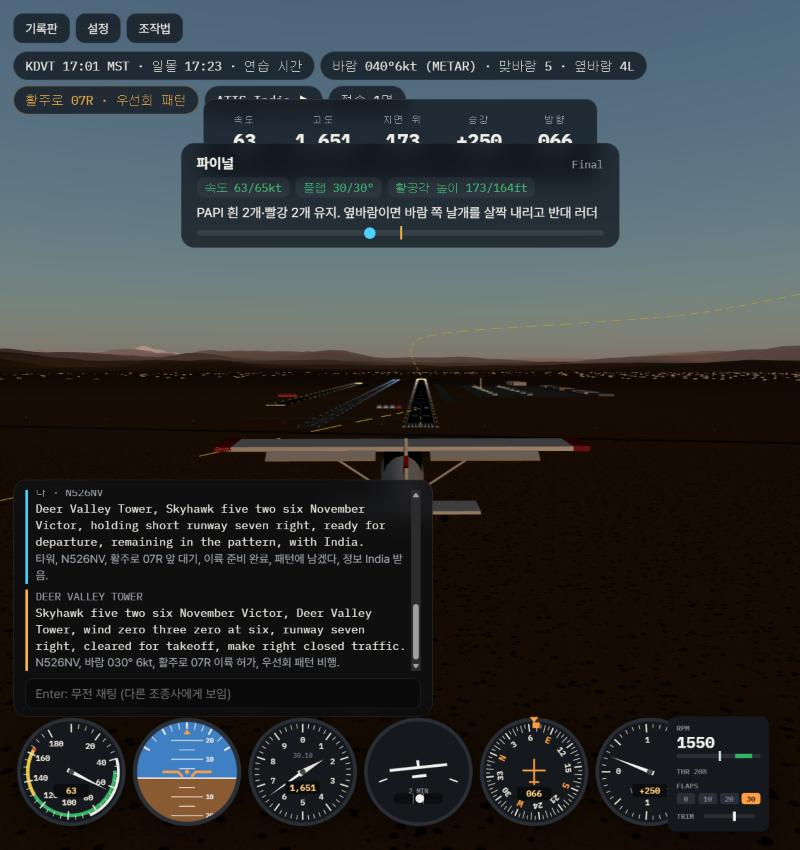
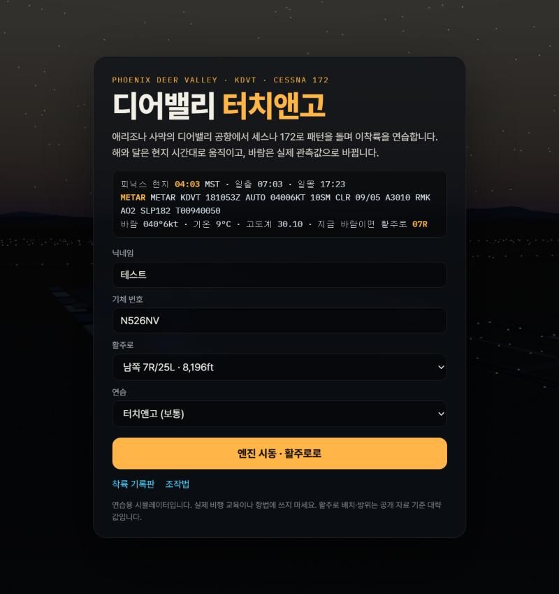
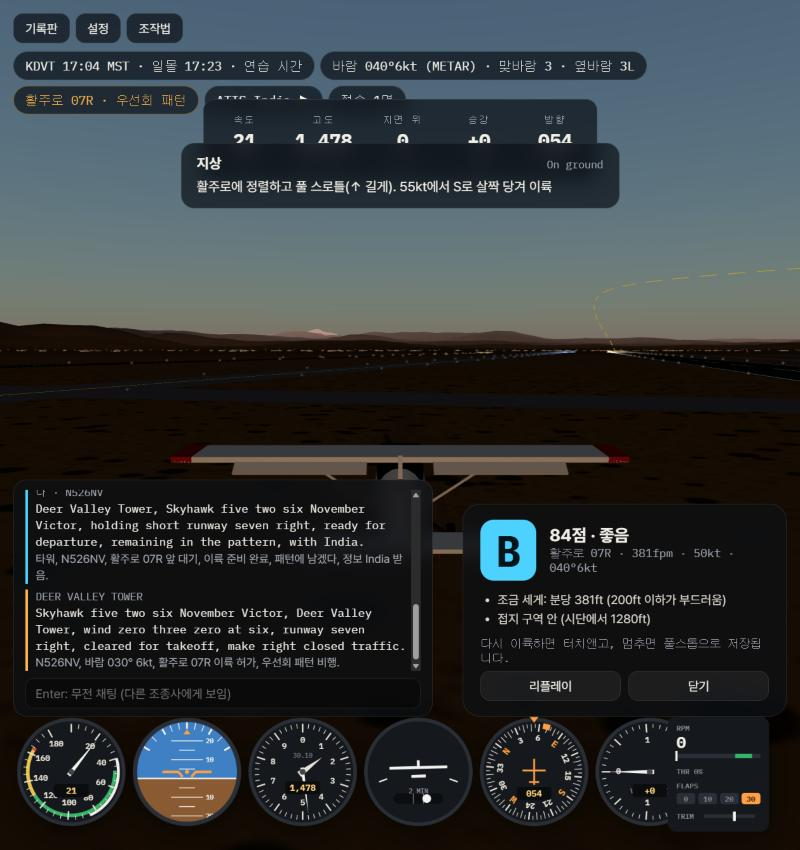
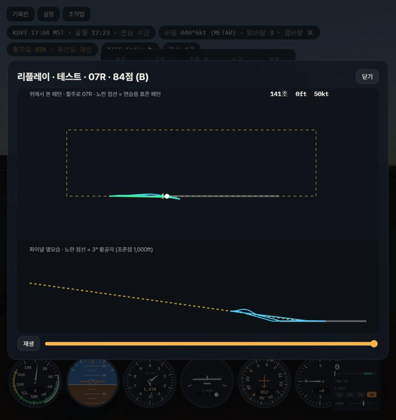
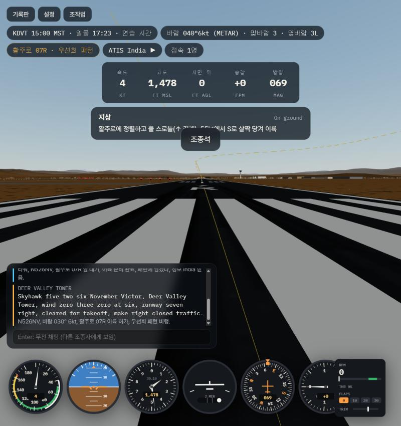

# 디어밸리 터치앤고

> 애리조나 피닉스 디어밸리 공항(KDVT)에서 세스나 172로 장주를 돌고 이착륙·터치앤고를 연습하는 3D 멀티플레이 웹

- **배포 주소:** https://dvt-pattern.onrender.com (첫 접속은 서버가 깨어나느라 30초쯤 걸릴 수 있습니다)
- **기획서:** [PRD.md](PRD.md)



## 무엇을 하나

| 기능 | 내용 |
|---|---|
| 실제 공항 | KDVT 활주로 두 개(07R/25L 8,196ft, 07L/25R 4,500ft, 간격 700ft), 표고 1,478ft, 남쪽 7R·북쪽 25R은 오른쪽 선회 패턴. 활주로 표시·번호, 유도로, 관제탑, PAPI, 활주로 등, 회전 비컨, 풍향계 |
| 24시간 해와 달 | 피닉스 현지 시간(MST, 서머타임 없음)으로 해·달 위치를 계산(NOAA 식). 노을·밤에는 도시 불빛과 활주로 등이 켜짐. 설정에서 시간을 직접 바꿀 수 있음 |
| 실제 바람 | aviationweather.gov의 KDVT **METAR**를 10분마다 받아 바람·기온·고도계를 반영하고, 바람 방향으로 쓸 활주로를 고름. 돌풍·풍향 흔들림, 지면 가까이서 약해지는 바람 |
| 연습 바람 | 바람 방향·세기·돌풍 직접 입력, 옆바람 연습 프리셋 |
| 세스나 172 | 실제 숫자에 가깝게: 약 55kt 이륙, 74kt 상승(분당 500~600ft), 약 48kt 실속, 실속 경고음, 플랩 0·10·20·30°, 트림. 조금 쉽게 다듬음 |
| 패턴 코치 | 지금 구간(이륙·업윈드·크로스윈드·다운윈드·베이스·파이널·착륙 활주)을 판정하고 할 일·목표 속도·플랩·활공각을 알려 줌. 노란 점선 안내선 |
| 관제 무전 | 이륙 허가, 다운윈드 보고와 순서 안내(앞 비행기가 있으면 "number two"), 터치앤고·풀스톱 허가, 복행. 영어 원문 + 한국어 번역, 음성으로 읽기. ATIS(정보 문자·바람·고도계·기온) |
| 체크리스트 | 착륙 전 5가지(K, 1~5). 다 하면 착륙 점수 +3 |
| 비상·옆바람 | 엔진 고장 모드: 다운윈드 옆에서 엔진이 꺼지고 활공으로 내려야 함. 옆바람 모드 |
| 착륙 채점 | 하강률·중심선·접지 위치·속도·크랩·기울기로 0~100점, A~D. **서버가 다시 계산**해 저장 |
| 기록판·로그북 | 오늘 / 이번 주 / 전체 / 내 로그북(횟수·평균·최고) |
| 리플레이 | 위에서 본 내 패턴과 표준 패턴, 파이널 옆모습과 3° 활공각 비교 |
| 멀티플레이 | 같은 주소에 들어온 사람의 비행기·닉네임 표시, 무전 채팅 |
| 시점 | 뒤(마우스로 둘러보기) / 조종석 / 관제탑(줌) |

| 시작 화면 | 착륙 결과 |
|---|---|
|  |  |
| **리플레이** | **조종석** |
|  |  |

## 조작법 (키보드)

| 키 | 동작 |
|---|---|
| S / W | 당기기(기수 들기) / 밀기 |
| A / D | 왼쪽 / 오른쪽 기울이기 |
| Q / E | 러더 (지상에선 앞바퀴 조향) |
| ↑ / ↓ | 스로틀 |
| F / V | 플랩 내리기 / 올리기 |
| [ / ] | 트림 |
| B | 브레이크 (누르고 있기) |
| C | 시점: 뒤 → 조종석 → 관제탑 |
| K, 1~5 | 착륙 전 체크리스트 |
| I | ATIS 듣기 |
| M | 지도 크게 |
| R | 활주로로 돌아가기 |
| Enter | 무전 채팅 |
| Esc | 설정 (시간·바람) |

처음이면: ↑를 길게 눌러 풀 스로틀 → 55kt에서 S를 살짝 → 74kt로 상승 → 노란 안내선을 따라 한 바퀴 → 파이널 65kt, 플랩 30° → 바닥 근처에서 ↓로 출력을 줄이고 S로 살짝 당기기.

## 구조

```
브라우저 (public/: 빌드 없음, three.js 0.169 importmap)
   ├ sim/     비행 모델·공항 좌표·해 위치·바람·패턴 판정·채점·관제 문장 (순수 JS, 서버와 공유)
   ├ world/   3D 공항·지형·하늘·조명, 세스나 172 모델
   └ ui/      계기판 캔버스, 소리·음성, 멀티 연결, 리플레이 그림
        │ fetch /api/…            │ WebSocket /ws
        ▼                         ▼
Express 5 서버 (server.js)   멀티플레이 중계 (src/multiplayer.js, ws)
   │ 입력 검사·점수 재계산 (src/landings.js + public/sim/scoring.js)
   │ METAR 받기·정리 (src/weather.js)
   ▼
Supabase Postgres (dvt_landings 표, db/schema.sql)
```

API 목록은 [PRD.md](PRD.md#6-api)에 있습니다.

## 과제 요구사항과 대응

| 요구사항 | 이 프로젝트 |
|---|---|
| 구현 전 PRD | [PRD.md](PRD.md): 문제·사용자·MVP·화면·데이터 구조 |
| 2개 이상 화면·기능, 입력 반영, 서버 데이터 표시 | 시작·비행·결과·기록판·리플레이·설정. 착륙 → 저장 → 기록판·로그북·리플레이에 표시 |
| 프레임워크로 API 서버와 CRUD | Express 5. 착륙 기록 생성(POST)·목록·한 건·로그북 조회(GET) |
| 실제 DB 저장·읽기 | Supabase Postgres `dvt_landings` |
| 배포 URL | Render (render.yaml) |
| GitHub에 코드와 PRD | 이 저장소 |

## 직접 실행

```bash
npm install
npm start          # http://localhost:3000
npm test           # 시험 12개
```

`.env`에 `DATABASE_URL`(Supabase 연결 주소)을 넣으면 Postgres에 저장합니다. 비워 두면 개발용 메모리 DB로 뜹니다(서버를 끄면 기록이 사라짐). 배포 환경(`NODE_ENV=production`)에서는 주소가 없으면 서버가 뜨지 않습니다.

시험 내용: 채점, 피닉스 하지·동지 일출·일몰(실제와 15분 이내), 활주로 배치, 바람 성분과 활주로 선택, 관제 문장, 실속 경고 속도, 자동 조종으로 07R·25L 패턴 한 바퀴 돌고 활주로에 접지, API 저장·검증·로그북, METAR 정리, 멀티플레이 두 접속자.

## 자료와 한계

- 공항 정보: FAA 공항 자료, AirNav, SkyVector 공개 자료. **활주로 배치·방위·주변 건물은 대략값**이고 실제 비행·항법에 쓰면 안 됩니다.
- 날씨: [aviationweather.gov](https://aviationweather.gov) Data API. 받지 못하면 바람 없음으로 시작하고 시작 화면에 알립니다(설정에서 직접 정할 수 있음).
- 비행 모델은 공개된 세스나 172 성능 숫자에 맞춘 단순 모델입니다. 실제 기체와 다릅니다.
- 관제 무전은 미리 정한 문장으로 만든 연습용이며 실제 KDVT 관제와 다릅니다.
- 무료 서버라 동시 접속은 60명까지로 막았고, 채팅·위치는 저장하지 않습니다.
